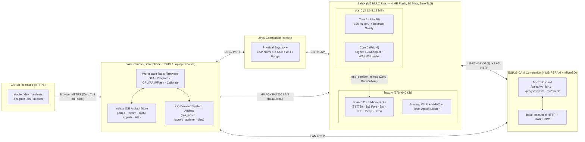

# BalaX Implementation Spec: Thin-Robot Offload, Shared Micro-BIOS, RAM-Loaded Applets, Minimal OTA Stub & External Storage

> **Status:** Engineering Specification (v2 — includes full `balax.map` offload audit, shared zero-duplication Micro-BIOS, and on-demand RAM-loaded updaters)
>
> **Scope:** `esp32-bot/balax` (ESP32-PICO-D4 / M5StickC Plus), `esp32-bot/balax-remote` (Companion Web App on phone/tablet/laptop), `g-ai/rc` (Shared TS/WASM Library), `JoyX` (Joystick + ESP-NOW ↔ USB/Wi-Fi Companion Bridge), and future `ESP32-CAM` companion module.

---

## 1. Core Philosophy: "Thin Robot" + "Don't Ship What Requires a Live Remote"

Two architectural laws govern every byte on BalaX:

1. **Thin Robot, Smart Remote:** Only put on BalaX what *must* run autonomously on the robot (deterministic 100 Hz balance/IMU control & safety interlocks on Core 1, minimal hardware primitives, minimal authenticated LAN/ESP-NOW transport, and a tiny verified RAM applet loader). Offload everything else (GitHub Releases OTA, 6-DOF fusion/calibration, HIL replay, dashboards, program editing/storage) to `balax-remote` + `@g-ai/rc` running on a smartphone, tablet, or laptop (with `JoyX` acting as both physical joystick and ESP-NOW ↔ USB/Wi-Fi companion bridge).
2. **The "Can't Do It Without Remote Already Live" Law:** If a feature *cannot even be invoked* unless `balax-remote` (or host CLI / CAM SD) is already connected and live — such as OTA flashing `ota_0`, self-updating `factory`, calibration wizards, diagnostic formatters, or custom melodies/demos — **do not ship that code permanently on the robot.** Store it on the remote (`balax-remote` / `IndexedDB` / `ESP32-CAM` SD), transmit it over Wi-Fi on demand, verify **HMAC-SHA256 + SHA-256** to guarantee authenticity & zero transit corruption, execute it in RAM, and immediately free the RAM when done!

### Non-Negotiable Safety & Hardware Constraints
- **Deterministic Core 1:** The 100 Hz IMU/balance loop (`robot.cpp`, Core 1, priority 20) must keep `tick_ms < 3.0 ms` and `overruns == 0`.
- **Thermal & Battery Safety (sealed M5StickC Plus 120 mAh LiPo, no battery thermistor):**
  - Default CPU stays **80 MHz**, `CONFIG_FREERTOS_HZ=200`, `WIFI_PS_MIN_MODEM`, `+13 dBm` max TX, LCD skipped at `brightness == 0`.
  - Pre-flight OTA gate requires `battery_pct >= 30%`, `pmic_c < 46 °C`, `imu_c < 58 °C` (overrideable with explicit `--force` / UI checkbox).
  - Running RAM applets auto-abort if `pmic_c >= 48 °C`, `imu_c >= 60 °C`, `DISARM`, or `FALLEN` fault.
- **Unbrickable over Wi-Fi:** Normal app updates never erase `factory`. Even if power dies mid-flash while erasing `ota_0`, BalaX boots straight into `factory` Wi-Fi rescue mode (with LCD status text + progress bar + LED/beep feedback).

---

## 2. Complete "Can't Do It Without Remote Already Live" Audit (`build/balax.map`)

Measured directly from current `build/balax.map` (`balax.bin = 1,306 KB`, free DRAM = `51 KB` of `175 KB`):

| # | Current Code/Data on Robot | Measured Cost | Why It Shouldn't Live Permanently on Robot | Remote-Offloaded / RAM-Loaded Replacement |
|---|---|---:|---|---|
| **1** | **Full-screen RGB565 LCD framebuffer & rich layout** (`status.cpp` 64.8 KB static `.bss` + `status_view.cpp` 5.2 KB + `canvas.cpp` 1.0 KB) | **6.2 KB Flash + 64.8 KB DRAM** | Detailed dashboards live in `balax-remote`; onboard screen only needs tiny status text & a loading bar | Reuse the **Shared 2 KB Micro-BIOS** in `factory` (zero-framebuffer direct ST7789 SPI + 3×5 font → **saves ~64 KB DRAM & ~6 KB Flash**!) |
| **2** | **On-robot GitHub HTTPS OTA + TLS stack** (`ota.cpp` 39.5 KB + `x509_crt_bundle` 66.1 KB + `mbedtls`/`tfpsacrypto` 215.6 KB + `esp_https_ota` 3.3 KB) | **~255 KB Flash + 32.8 KB DRAM** | GitHub OTA requires network & user selection anyway — browser already has HTTPS/TLS for free | `balax-remote` fetches GitHub `stable`/`dev` manifest & `.bin`, verifies SHA-256, caches in `IndexedDB`, compresses `zlib -9`, pushes over uniform LAN OTA |
| **3** | **C++ `<charconv>` float formatter tables** (`floating_to_chars.o` 120.4 KB + `floating_from_chars.o` 20.5 KB) | **140.9 KB Flash** | Only used to pretty-print/parse CLI text for a connected user/remote | Replace with minimal `snprintf`/`strtof` (or binary telemetry decoded by `balax-remote`) |
| **4** | **Interactive serial/LAN CLI & line editor** (`linenoise.c` 6.9 KB + `esp_console` 8.8 KB + `stdio_vfs` 97 KB + `commands.cpp` 2.3 KB) | **~115 KB Flash** | Interactive CLI help, tab completion, and formatted tables only run when a remote/terminal is connected | Keep compact binary/key-value RPC on robot; let `balax-remote` render human-readable consoles, help, and tables |
| **5** | **OTA writer / decompressor logic (`ota_0` updater)** | **~8–15 KB Flash + 32 KB scratch RAM** | Physically impossible to OTA over Wi-Fi without the remote already live! | Ship only a **~50-line HMAC+SHA-256 RAM Applet Loader** in `factory`; remote streams the **`ota_writer` applet** (~3 KB) right before streaming `balax.bin.z`! |
| **6** | **`factory` partition self-updater** | **0 KB permanent** | Upgrading `factory` is rare and always triggered from a live remote | Remote streams a signed **`factory_updater` RAM applet** into `ota_0`'s RAM (copies 2 KB Micro-BIOS to RAM to keep showing the LCD progress bar while updating `factory`!), verifies SHA-256, and frees itself |
| **7** | **IMU calibration routines** (`imu_calibration.cpp` 3.3 KB) | **3.3 KB Flash** | Guided 6-side & CG calibration already runs in `balax-remote` | Keep only ~300 B NVS bias/scale/CG load+apply on robot; run calibration sampling via live 100 Hz stream or RAM applet and write 9 floats to NVS |
| **8** | **Custom melodies, dances, HIL test sweeps** (`sounds.h`, future maneuvers) | **Unbounded growth** | Only needed when triggered | Keep 2 tiny safety beeps in shared Micro-BIOS; stream custom melodies/maneuvers from `IndexedDB` or CAM SD as tiny RAM applets |
| **9** | **Telemetry stream static buffers** (`telemetry_stream.cpp` 9.5 KB DRAM) | **9.5 KB DRAM** | Only needed while a remote or SD recorder is actively streaming | Allocate buffers dynamically on stream start and free completely on `stream stop` / disconnect |

**Combined immediate resource reclaim (Phases 0–1 alone, before even changing partitions!):**
- **Flash:** `1,306 KB` → **`~850–900 KB`** (`~550 KB` compressed over Wi-Fi!)
- **Free DRAM heap:** `51 KB` → **`~140–155 KB` free DRAM** (**nearly 3× more free RAM!**)

---

## 3. System Architecture Overview



---

## 4. Part 1 — Shared Zero-Duplication Micro-BIOS (`factory`) + 3.12–3.19 MB App Slot

### 4.1 Flash Partition Table (`partitions.csv`)

```csv
# Name,      Type, SubType,  Offset,   Size
nvs,         data, nvs,      0x9000,   0x6000
otadata,     data, ota,      0xf000,   0x2000
phy_init,    data, phy,      0x11000,  0x1000
factory,     app,  factory,  0x20000,  0xA0000
ota_0,       app,  ota_0,    0xC0000,  0x320000
telemetry,   data, 0x99,     0x3E0000, 0x10000
coredump,    data, coredump, 0x3F0000, 0x10000
```

*(Once `ota_stub.bin` is compiled and measured, if `<= 550 KB`, tighten `factory` to `0x90000` (576 KB) and expand `ota_0` to `0x330000` (**3,264 KB = 3.19 MB**).)*

### 4.2 Shared Micro-BIOS Inside `factory` (~2.0 KB Flash, 0 B Static DRAM, Zero Duplication)

Lives in a dedicated 4 KB flash-aligned section inside `factory` (`bios_page`, placed at a fixed offset right before the end of `factory`, e.g. `factory_end - 0x1000`, compiled as self-contained `-fPIC` register-only C with **zero libc / FreeRTOS symbol dependencies** so upgrading ESP-IDF in `ota_0` never breaks ABI!):

| Primitive | Physical Minimum Implementation | Flash Cost | Static DRAM |
|---|---|---:|---:|
| **Tiniest readable font** | Packed **`3×5` bitmap font** (uppercase `A–Z`, `0–9`, `.:/%+-!?`, 15 bits/glyph × 48 glyphs = **90 bytes**!) with integer `scale` (`1×`, `2×`, `3×`) | **90 B** | 0 B |
| **ST7789V2 LCD direct draw** | Direct SPI register window-fill (`CASET`/`RASET`/`RAMWR`) using a 64-byte stack burst buffer — **no 64.8 KB framebuffer!** Includes `lcd_init`, `lcd_clear`, `lcd_rect`, `lcd_text`, `lcd_bar(x,y,w,h,pct,fg,bg)` | **~1.2 KB** | 0 B |
| **Speaker** | Direct LEDC PWM timer/channel setup on `GPIO2` (`beep(hz, ms)`) | **~250 B** | 0 B |
| **Red LED** | Direct `GPIO10` active-low register write (`led_set(on)`) | **~40 B** | 0 B |
| **Buttons** | Direct `GPIO37` (Btn A) & `GPIO39` (Btn B) reads + minimal I2C poll of AXP192 reg `0x46` (Power button short/long press) | **~220 B** | 0 B |
| **Versioned Jump Table** | Fixed header with magic `0x42584249` (`"BXBI"`), `abi_version = 1`, `size_bytes`, `crc32` | **~128 B** | 0 B |
| **Total Micro-BIOS** | **Complete UI + Audio + Buttons + LED + Font + Progress Bar** | **~2.0 KB** | **0 B** |

**ABI Structure (`shared/balax_bios.h`):**
```c
#define BALAX_BIOS_MAGIC   0x42584249u  // "BXBI"
#define BALAX_BIOS_ABI_VER 1u

typedef struct {
    uint32_t magic;
    uint16_t abi_version;
    uint16_t code_bytes;
    uint32_t crc32;           // CRC32 over entire 4 KB bios_page (excluding crc32 field)
    const uint8_t* font_3x5;  // 48 glyphs x 2 bytes (96 bytes), 3x5 packed bits
    void    (*led_set)(bool on);
    void    (*beep)(uint16_t hz, uint16_t ms);
    uint8_t (*buttons_read)(void); // bit0=BtnA, bit1=BtnB, bit2=PwrShort, bit3=PwrLong
    void    (*lcd_init)(uint8_t brightness_pct);
    void    (*lcd_backlight)(uint8_t brightness_pct);
    void    (*lcd_clear)(uint16_t rgb565);
    void    (*lcd_rect)(int16_t x, int16_t y, int16_t w, int16_t h, uint16_t rgb565);
    void    (*lcd_text)(int16_t x, int16_t y, const char* s, uint16_t fg, uint16_t bg, uint8_t scale);
    void    (*lcd_bar)(int16_t x, int16_t y, int16_t w, int16_t h, uint8_t pct, uint16_t fg, uint16_t bg);
} balax_bios_v1_t;
```

**How `ota_0` reuses `factory`'s Micro-BIOS with zero duplication:**
1. On boot, `ota_0` locates `factory` via `esp_partition_find_first(ESP_PARTITION_TYPE_APP, ESP_PARTITION_SUBTYPE_APP_FACTORY, NULL)`.
2. Maps the 4 KB `bios_page` into instruction/data space via `esp_partition_mmap(..., SPI_FLASH_MMAP_INST)` (or copies the tiny 2 KB PIC image into a 2 KB IRAM buffer — **bonus:** copying 2 KB to IRAM means `lcd_text`, `lcd_bar`, `beep`, and `led_set` keep working even **during SPI flash erases** when `factory` or `ota_0` flash cache is disabled!).
3. Verifies `magic == BALAX_BIOS_MAGIC`, `abi_version == 1`, and `crc32`, then uses `bios->...` for all onboard display text, loading bars, LED, buttons, and beeps — **zero duplicated display/font/speaker code in `ota_0`!**

### 4.3 Mathematically Minimal `factory` Partition (`ota_stub`, Target ≤ 550 KB)

Because `ota_writer` is streamed into RAM on demand from `balax-remote`, `factory` itself contains ONLY the absolute irreducible floor needed to receive a verified Wi-Fi payload and display status:
1. **Pure C only** (`-Os`, no `libstdc++.a`, no `mbedtls`, no `esp_http_server`, no `mdns` component, no `console`, no `esp_now`, `CONFIG_LOG_DEFAULT_LEVEL_NONE=y`, `CONFIG_ESP_WIFI_SOFTAP_SUPPORT=n`, `CONFIG_LWIP_IPV6=n`, `80 MHz`).
2. **Wi-Fi STA** (reads creds + 32-byte `lan_auth` key from NVS `balax_net`, fallback compiled header) + **30-line raw UDP `balax.local` mDNS responder**.
3. **ESP32 Mask ROM `esp_rom_sha256`** for 25-line **HMAC-SHA256** + **SHA-256** verification.
4. **Shared 2 KB Micro-BIOS** (shows `OTA READY`, IP, progress bar `0–100%`, and error/done beeps).
5. **Tiny `POST /api/exec_ram` + fallback `POST /api/ota` loader** (~80 lines of C): receives a verified RAM applet (or direct compressed stream), checks HMAC-SHA256 + SHA-256 **before executing a single instruction**, and runs it!
6. **Failsafe watchdog:** If idle for 60 s and `ota_0` validates, auto-reboots into `ota_0`; if `ota_0` is invalid (e.g. battery died mid-flash), stays in `factory` showing `RESCUE MODE` on LCD and blinking LED for instant Wi-Fi recovery!

---

## 5. Part 2 — Verified On-Demand RAM Applets (System Updaters & User Mini-Programs)

### 5.1 Two Execution Tiers, One Security Gate

Every executable streamed to BalaX over Wi-Fi (or loaded from `ESP32-CAM` SD) MUST pass:
1. **Authentication:** `X-Signature == HMAC-SHA256(lan_auth_key, X-Nonce || payload)` (constant-time compare).
2. **Integrity (anti-transit-corruption):** `SHA-256(payload) == X-Payload-Sha256` verified over the complete RAM buffer **before** any byte is parsed or executed.
3. **Thermal & Heap Gate:** Refuses execution if `pmic_c >= 48 °C` or `free_heap < 36 KB`.

| Applet Tier | Execution Engine | Size Limit | Use Cases |
|---|---|---:|---|
| **Tier 1A — Sandboxed User Mini-Programs** | **WASM3 VM** in DRAM (Core 0, Priority 4; isolated from Core 1 Priority 20 balance loop) | `<= 16 KB` `.wasm`, `<= 8 KB` linear mem | Custom maneuvers, HIL sweeps, dances, melodies, calibration routines, diagnostics |
| **Tier 1B — Privileged System RAM Applets** | Signed tiny native Xtensa IRAM stub (like `esptool`'s RAM flasher, verified by HMAC + SHA-256, ~2–4 KB) OR privileged WASM host calls | `<= 8 KB` | **`ota_writer`** (streams `zlib -9` via ESP32 ROM `tinfl` into `ota_0` + draws BIOS progress bar), **`factory_updater`** (runs in `ota_0` RAM to safely overwrite & CRC-verify `factory` + Micro-BIOS over Wi-Fi!) |

### 5.2 How Remote-Loaded `ota_writer` and `factory_updater` Work

**Updating the Big App Slot (`ota_0`, 3.12 MB):**
1. `balax-remote` runs pre-flight check (`battery >= 30%`, `pmic < 46 °C`, `imu < 58 °C`).
2. `balax-remote` calls `POST /api/ota/enter` → BalaX boots `factory` (~2 s). LCD prints `OTA MODE` using Micro-BIOS.
3. `balax-remote` uploads the signed **~3 KB `ota_writer` applet** via `POST /api/exec_ram` (HMAC + SHA-256 verified before execution).
4. `ota_writer` starts listening for the compressed stream, calls ESP32 Mask ROM `tinfl_decompress` on incoming `zlib -9` chunks (`1,306 KB → 863 KB`, **-34% smaller/faster**), writes straight to `ota_0`, updates `bios->lcd_bar(pct)` live on screen, verifies raw SHA-256, sets boot slot to `ota_0`, plays a 2-note chime via `bios->beep()`, and reboots!

**Updating the Tiny `factory` Partition Itself Over Wi-Fi (Zero USB Needed!):**
1. While running normally in `ota_0`, `balax-remote` uploads the signed **~3 KB `factory_updater` applet** via `POST /api/exec_ram` (HMAC + SHA-256 verified!).
2. `factory_updater` copies the 2 KB Micro-BIOS into IRAM (so the LCD progress bar stays live while `factory` is erased!), streams the new compressed `ota_stub.bin.z` via ROM `tinfl` into `0x20000` (`factory`), verifies full SHA-256 of the written `factory` flash + `balax_bios_v1_t.crc32`, plays a confirmation beep, and exits — freeing all RAM with **zero reboot required**!

### 5.3 Safe WASM3 Host ABI (`balax` Module Imports)

```c
// Motion & Mode Control (clamped to [-100, +100], subject to Core 1 safety & 500 ms stick timeout)
void    balax_set_stick(int32_t fwd_pct, int32_t turn_pct);
void    balax_arm(void);
void    balax_disarm(void);
void    balax_takeoff(void);

// Read-Only Telemetry (atomic snapshot from Core 1)
int32_t balax_state(void);            // 0=CALIB, 1=READY, 2=LEVEL, 3=BALANCING, 4=FALLEN
int32_t balax_pitch_cdeg(void);
int32_t balax_roll_cdeg(void);
int32_t balax_yaw_cdeg(void);
int32_t balax_accel_mg(int32_t axis);
int32_t balax_gyro_mdps(int32_t axis);
int32_t balax_battery_pct(void);
int32_t balax_pmic_dc(void);

// Shared Micro-BIOS UI, Feedback, Timing & Logging
void    balax_lcd_clear(int32_t rgb565);
void    balax_lcd_text(int32_t x, int32_t y, int32_t ptr, int32_t len, int32_t fg, int32_t scale);
void    balax_lcd_bar(int32_t pct);
void    balax_beep(int32_t hz, int32_t ms);
void    balax_led(int32_t on);
int32_t balax_buttons(void);
int32_t balax_sleep_ms(int32_t ms);   // returns 1 if abort requested
int32_t balax_uptime_ms(void);
void    balax_log(int32_t code, int32_t value);
```

---

## 6. Part 3 — Unified External Storage (`GitHub`, `Browser IndexedDB`, `ESP32-CAM SD`) & `JoyX` Bridge

### 6.1 Shared Artifact Interface (`@g-ai/rc/src/artifactStore.ts`)

Every storage source — **GitHub Releases (`stable`/`dev`)**, **Local Build**, **Browser Cache (`IndexedDB`)**, and **ESP32-CAM SD Card** — implements the same `ArtifactStore` contract for:
- `firmware` (`.bin.z` for `ota_0` or `factory`)
- `applet` (`.bin`/`.wasm` system updaters like `ota_writer` / `factory_updater` and diagnostics)
- `wasm` (user mini-programs)
- `hil` (compressed 100 Hz telemetry recordings)

### 6.2 GitHub Releases OTA in `balax-remote` (`@g-ai/rc/src/githubOta.ts`)
- Fetches `stable` / `dev` manifests directly over browser HTTPS, compares version/SHA-256 against BalaX's running version, downloads & verifies SHA-256, caches in Browser `IndexedDB` (`balax_storage_v1`), compresses `zlib -9`, and pushes via the exact same uniform OTA pipeline!

### 6.3 JoyX Companion Bridge Role
- Connects to a smartphone or laptop running `balax-remote` over **USB Serial (WebSerial)** or **Wi-Fi**, forwarding low-latency physical joystick inputs and acting as an **ESP-NOW ↔ Browser bridge** when no Wi-Fi router is present — keeping all heavy UI, networking, calibration, and GitHub OTA logic off both JoyX and BalaX.

### 6.4 ESP32-CAM SD Card Companion Architecture
- **Power & thermal safety:** Power ESP32-CAM from the BalaC base's external 5 V / dedicated LiPo rail (common GND with M5StickC Plus — **never** from the stick's 120 mAh battery!), with an air gap so M5StickC Plus heat can dissipate.
- **SD-1-bit-safe UART wiring (SD uses `GPIO 2, 14, 15`):** M5StickC Plus Grove `G32/G33` ↔ ESP32-CAM `GPIO3 (U0RX) / GPIO1 (U0TX)` + `GND` at `921600 baud`.
- **MicroSD layout:** `/balax/manifest.json`, `/balax/fw/*.bin.z`, `/balax/applets/*`, `/balax/progs/*.wasm`, `/balax/hil/*.bxz2`.
- **Dual-path access:**
  - *LAN HTTP (`balax-cam.local`, HMAC-SHA256 authenticated):* browsed directly by `balax-remote` and fetchable by `balax.local`.
  - *Direct UART RPC (router-free offline field mode):* `[0xB5 0x5B][cmd:1][seq:1][len:2][payload][crc32:4]` for offline `.wasm` loading, offline SD firmware swaps, and gigabyte-scale HIL logging.

---

## 7. Part 4 — Flash Wear Minimization & Multi-Tier Caching / Eviction Architecture

ESP32 SPI NOR flash is rated for `~100,000` program/erase cycles per 4 KB sector — **reads are free (infinite cycles), RAM writes cause zero wear, and only 4 KB sector erases cause wear.** Our caching architecture is designed so normal remote-driven sessions cause **zero internal NOR flash erases**, while avoiding redundant re-downloads across restarts and offline sessions.

### 7.1 Four-Tier Wear-Aware Storage Hierarchy

| Tier | Location | Capacity | Robot Flash Wear | Primary Role | Eviction Policy |
|---|---|---:|---|---|---|
| **Tier 0** | **BalaX DRAM Applet Cache** (from `+93 KB` reclaimed heap) | 24–32 KB | **0 erases (zero wear)** | Hot `.wasm` mini-programs, melodies, diagnostics, & transient remote runs | **Pinned + TinyLFU / Clock-Pro** (active applet pinned; never writes to flash!) |
| **Tier 1** | **BalaX SPI NOR Flash Cache** (optional wear-leveled log ring inside `telemetry`/`cache`) | 64–128 KB | Low (strictly guarded) | Only offline/field-pinned or proven multi-hit `.wasm` applets when no CAM SD is present | **2-Hit Write Admission + Cost-Aware W-TinyLFU** + circular log wear-leveling |
| **Tier 2** | **ESP32-CAM MicroSD** (hardware wear-leveled NAND) | GBs (quota e.g. 512 MB) | **0 robot NOR wear** | Offline `.bin.z` firmwares, `.wasm` library, gigabyte HIL logs | `SHA-256` dedup + Pinned + LRU quota cleanup |
| **Tier 3** | **Browser `IndexedDB`** (`balax-remote` on phone/tablet/laptop) | 50–250 MB | **0 robot NOR wear** | Primary long-term cache for GitHub releases, local builds, `.wasm` applets, & HIL captures | `SHA-256` dedup + Pinned (active robot version protected!) + Cost-Aware W-TinyLFU |

### 7.2 Five Rules That Virtually Eliminate Robot NOR Flash Wear

1. **RAM-First Execution (Never Touch Flash for Transient Runs):**
   - Whenever `balax-remote` is connected over Wi-Fi, uploading a 4 KB `.wasm` applet takes `< 15 ms` directly into **Tier 0 DRAM** — **0 flash sectors erased**.
   - Repeated runs of the same applet check its `SHA-256` against the **Tier 0 DRAM Cache** first: cache hit = **0 Wi-Fi transfer AND 0 flash wear!**
2. **Content-Addressed Deduplication (`SHA-256` First Everywhere):**
   - Every artifact is keyed by its raw `SHA-256`. Before writing to Tier 0/1/2/3 (or before flashing OTA), check if that exact `SHA-256` is already present — if yes, reuse immediately with **zero write/erase**.
3. **Sector-Skip Differential OTA (`ota_writer` & `factory_updater`):**
   - During OTA flashing, for every decompressed 4 KB sector `i`, `ota_writer` reads the existing 4 KB sector currently in flash and runs `memcmp`.
   - If the 4 KB sector is **byte-identical**, **skip both `esp_flash_erase_region()` and `esp_flash_write()`!**
   - On incremental firmware tweaks, unchanged ESP-IDF/Wi-Fi/LwIP/FreeRTOS sectors are skipped automatically — cutting NOR flash erase wear AND flashing time by **40–80%**!
4. **Zero-Write Read Tracking + 2-Hit Write Admission (No One-Hit-Wonder Flash Thrashing):**
   - Access timestamps and frequency counters live **strictly in RAM** (never written back to NOR flash on reads!).
   - An artifact is **never written to Tier 1 NOR flash on its 1st use** unless explicitly `pinned` for offline field use. It must earn at least **2 hits** (and outscore the lowest-value victim in flash) before earning a flash write.
5. **Log-Structured Circular Wear-Leveling (No Hot Metadata Sector):**
   - Tier 1 NOR flash cache writes append sequentially around a circular 4 KB-sector ring (`[magic][sha256][len][flags][crc32][payload]`), reclaiming stale/evicted sectors in ring order so **every sector in the partition ages evenly** instead of burning out sector 0.

### 7.3 Cost-Aware W-TinyLFU Eviction Score (Shared Across Tiers)

When any cache tier reaches its byte budget, unpinned entries are evicted in ascending order of retention value:

$$\text{score}(e) = \frac{\text{freq}_{\text{decayed}}(e) \cdot \text{cost}_{\text{refetch}}(e)}{\text{age}_{\text{min}}(e) \cdot \text{size}_{\text{KB}}(e)}$$

- **`pinned == true`** (active robot firmware, user-starred offline programs, current rescue applets): $\text{score} = \infty$ — **never auto-evicted**.
- **`freq_decayed(e)`**: Frequency counter halved periodically (aging window) so an old program run 20 times last month doesn't block a program you're actively iterating on today.
- **`cost_refetch(e)`**: Higher weight for items costly to re-acquire (e.g. `4.0` for GitHub HTTPS releases when offline, `2.0` for large compressed firmwares, `1.0` for tiny local `.wasm` scripts).
- **`size_KB(e)`**: Slightly prefers keeping multiple small hot applets over one giant rarely used blob.

### 7.4 Live Flash Wear & Cache Telemetry (`Flash` Tab in `balax-remote`)
- `ota_writer` reports `{ sectors_erased, sectors_skipped, bytes_written }` after every OTA.
- BalaX tracks a monotonic `flash_erases_total` counter (incremented in NVS only once per OTA/flash-cache wrap — zero extra wear!) and exposes `cache_hits`, `cache_misses`, `ram_cache_kb`, and `flash_erases_total` via `probe`, displayed right inside the **Flash** monitor tab!

---

## 8. Phased Implementation & Verification Plan

| Phase | Deliverable | USB Flash? | Key Measured Targets & Acceptance Tests |
|---|---|:-:|---|
| **Phase 0** | Offload GitHub Releases OTA to `balax-remote` (`stable`/`dev` HTTPS fetch + SHA-256 + `IndexedDB`); strip `libota.a` & `mbedtls`/`tfpsacrypto` using ESP32 ROM SHA-256; replace `<charconv>` float formatting (`-141 KB`!) & switch `status.cpp` off static 64.8 KB framebuffer (`+60 KB` DRAM!) | No (Wi-Fi OTA) | GitHub OTA works from browser; `./tools/bx test` passes; `balax.bin < 950 KB`; live `ram_free_kb > 135 KB` (nearly 3× today!) |
| **Phase 1** | Shared Browser `IndexedDB` Artifact Store (`@g-ai/rc`) + `zlib -9` compressed OTA streaming (`-34%` wire size) in `balax-remote` & `tools/lan.py` | No | Cache GitHub/local `.bin.z` offline with SHA-256 dedup & W-TinyLFU eviction (pinned items protected), verify roundtrip, flash compressed image cleanly |
| **Phase 2** | Build `ota_stub/` (`factory` ≤ 576–640 KB) containing Shared **2 KB Micro-BIOS** (`balax_bios_v1_t`: ST7789 + 3×5 font + bar + LED + beep + buttons) + HMAC+SHA-256 RAM Applet Loader + `ota_writer` & `factory_updater` applets + new `partitions.csv` (`3.12–3.19 MB ota_0`) | **Yes (1× only)** | `ota_stub.bin <= 576 KB`; `ota_0` reuses `factory` Micro-BIOS with 0 duplication; verify power-cut mid-flash stays in `factory` rescue mode; verify sector-skip OTA skips unchanged 4 KB sectors (`sectors_skipped > 0`); verify `factory_updater` updates `factory` over Wi-Fi while showing live LCD bar |
| **Phase 3** | Integrate **WASM3 VM** (`main/prog_vm.*`) + safe Host ABI (exposing Micro-BIOS UI + sensors + clamped stick) + `Programs` tab in `balax-remote` | No (Wi-Fi OTA) | Load & run `.wasm` in `< 100 ms` with Tier-0 DRAM cache hit = 0 re-download & 0 flash erases; Core 1 `overruns == 0` under busy WASM loop; `DISARM` & thermal cutoff abort immediately |
| **Phase 4** | **ESP32-CAM SD Card** companion (`balax-cam.local` HTTP + UART RPC) + **JoyX** USB/Wi-Fi companion bridge | Flash CAM / JoyX | Browse/load `/balax/progs/*.wasm` & `/balax/fw/*.bin.z` from browser & BalaX; JoyX bridges cleanly to `balax-remote` |

---

## 9. Implementation Status, Live Benchmarks & Handoff (2026-11-22)

### 9.1 Implementation and prior hardware benchmarks
- **Slim Firmware (`balax`)**:
  - Replaced `libota.a`, `mbedtls`, and `espressif/mdns` with the slim [LAN server](../main/lan_server.cpp), [ESP32 ROM SHA-256](../main/sha256_hmac.h), and UDP mDNS for `balax.local` (**14.4 ms** in the prior hardware run).
  - Replaced the 64.8 KB static LCD framebuffer with a 2.7 KB strip guarded by the LCD mutex. The combined status view uses the Arduino-style horizon and dual-slot-era widgets. The compact OTA and program display primitives remain available through the [Micro-BIOS](../main/micro_bios.h).
  - **Prior firmware measurements at 80 MHz with `WIFI_PS_MIN_MODEM`**. That build also used an unpublished shared settings formatter. These measurements predate the combined status view.
    - `balax.bin`: `1,306 KB → 1,046 KB` raw (**`704.6 KB`** `zlib -9`, 67.4%).
    - `ram_free_kb`: `51 KB → 140.2 KB` (`ram_min_kb = 137.3 KB`).
    - `cpu0_load`: **`67.9% → 2.7%–13.5%`**; `cpu1_load`: `6.3%`.
    - Live compressed OTA (`zlib -9` + 4 KB sector-skip): verified end-to-end (`21.8 s`, `47 KB/s eff`, `250 erased, 6 skipped`).
  - Added **1-RTT `X-Next-Nonce` pipelining** on `/api/stream` and `/api/cmd` plus a **4-slot one-time-use nonce ring** (~112 B RAM) for concurrent `balax-remote`, `bx lan-cmd`, and phone clients. Local build verification is complete. A robot test remains pending.
  - Added **BXP1 Sandbox Mini-Program VM + Tier-0 DRAM Cache** (`main/prog_vm.*`, `/api/prog/*`) and standalone pure-C **`ota_stub/`** (`634.9 KB`, fits `0xA0000` in [`partitions_compact.csv`](../partitions_compact.csv)).
- **Shared 3D UI Framework (`~/gh/g-ai/3d-ui`, `@g-ai/3d-ui`)**:
  - Transferred `foss-earth/ui` → `https://github.com/g-AI-org/3d-ui`, moved local checkout to `~/gh/g-ai/3d-ui`, renamed package to `@g-ai/3d-ui`, added `silent?: boolean` & `isRemoved?()` to `createGameLog`, added React `<GameLogOverlay />` + `useGameLog()` (`src/shell/GameLogOverlay.tsx`), built, and **pushed to `origin/main` (`35296d1`)**.
  - `typecheck`, `lint`, `build`, and 623/629 Vitest tests pass (only pre-existing 6 failures in `src/browser/theme.test.ts` under Node 26 `localStorage`).
- **Shared RC Library (`~/gh/g-ai/rc`, `@g-ai/rc`)**:
  - Added browser `IndexedDB` + W-TinyLFU + GitHub Releases + optional CAM SD [`artifactStore.ts`](https://github.com/g-AI-org/rc/blob/main/src/artifactStore.ts) and [`balaxProgramCompiler.ts`](https://github.com/g-AI-org/rc/blob/main/src/balaxProgramCompiler.ts).
  - Removed stale duplicated UI files (`tabs.tsx`, `tabs.css`, `gameLog*`); `@g-ai/3d-ui` is now the single source of truth for 3D UI components.
- **Web Remote (`~/gh/esp32-bot/balax-remote`)**:
  - Uses **`@g-ai/3d-ui`** for responsive docked tabs and windows (`WindowOverlay`) and the floating activity log (`GameLogOverlay`).
  - Upgraded `telemetryBridgePlugin.ts`: 750 ms DNS lookup timeout + 60 s cached fallback IP, 1-RTT `X-Next-Nonce` pipelining, self-pacing `setTimeout` loop with configurable `targetHz` (`POST /api/bridge/rate`, `1–50 Hz`, default `20 Hz`), async 1 s buffered gzip session recording, and live `streamMetrics` in `/api/bridge/trace` & `/api/bridge/status`.
  - Added live rate HUD pill (`Hz · ms`), Telemetry tab **Update Rate** presets (`2 / 5 / 10 / 20 / 30 Hz` plus a `1–50 Hz` slider), OTA and Programs panels, and Flash wear and DRAM cache cards.
  - The Flash monitor uses the robot's `partitions` command through `GET /api/bridge/flash`. Data refreshes on connect, tab open, and manual refresh. The OTA panel identifies the development machine's binary as a local build.

### 9.2 Core-affinity audit

| Task | Affinity | Rationale |
|---|---|---|
| `robot` | Core 1, priority 20 | The 100 Hz balance loop reads the IMU, uses the FPU and drives the motors. |
| `status`, `remote`, `bxvm` | Core 0 | These tasks use floating point. Status also samples CPU counters and renders the LCD. |
| HTTP server and UART console REPL | Core 0 | Command callbacks may use the FPU. Wi-Fi also runs on Core 0. |
| `mdns_mini`, speaker, OTA reboot and entry timers, lwIP TCP/IP | Unpinned | These helpers use integer paths. The mDNS responder reads the cached integer IP. |

ESP-IDF pins a floating-point task to the core on which it first uses the FPU.
The 200 Hz tick on Core 0 also drives the timing that wakes the Core 1 balance loop.
Keep the LAN log ring's interrupt-masked copies bounded. The status renderer
draws from published telemetry on Core 0.

### 9.3 Remaining hardware and migration checks

1. Compare `balax lan-cmd "partitions"` with the browser Flash map on a reachable robot. Check live reconnect and OTA cache invalidation, LCD readability, and `probe tick_ms overruns` with the LCD on and off. Flash only with approval.
2. Verify the nonce ring under simultaneous LAN clients and exercise BXP1 upload and a zero-byte Tier-0 cache hit from the Programs tab.
3. Keep the A/B partition table as the default. The compact factory and app layout remains an optional one-time USB migration.
4. The separate `@foss-earth/ui` migration has work in progress on 18 local `migrate-g-ai-3d-ui` branches. Review those changes before publishing them.
5. Wire the ESP32-CAM SD companion (`balax-cam.local`) and JoyX ESP-NOW ↔ USB/Wi-Fi bridge.
